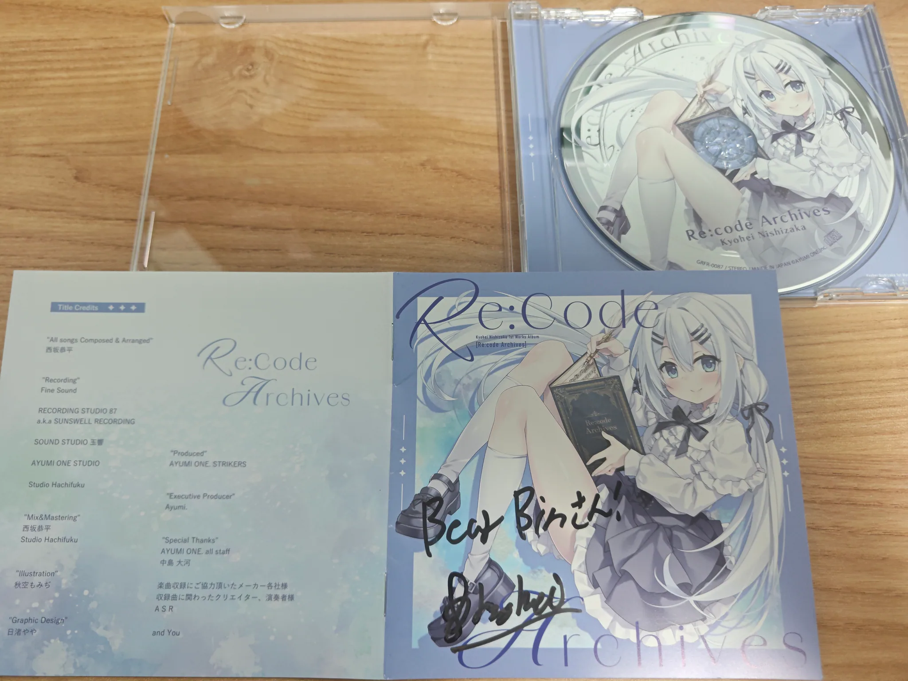
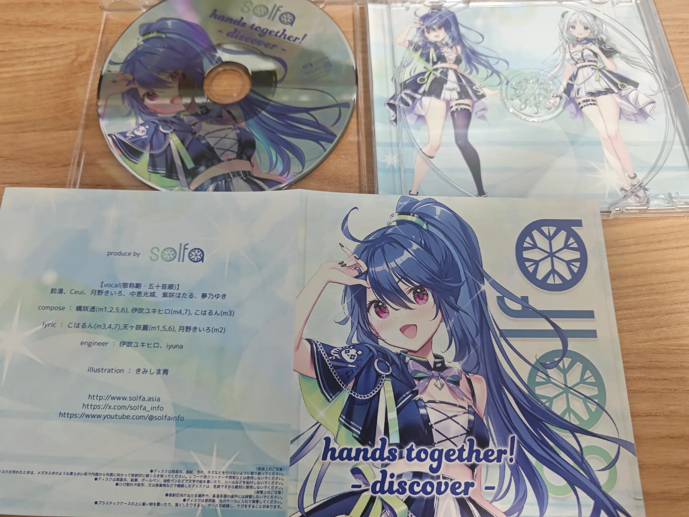

2026年秋[M3](https://mzh.moegirl.org.cn/Music_Media-Mix_Market) 于10月25日在东京流通中心举办。本次我也是买了点专辑，就写篇博客记录一下感想。

这次一共是买了10张新专辑，4张场贩、6张通贩，跟春M3差不多。大多数专辑来自之前不感兴趣的社团，属于是相当惊喜的一次。

## 开箱视频

:::bilibili BV13ayxzpE4B

## 场贩

跑场贩基本就是为了场贩限定或者签名去的。找代购跑了4张场贩专辑，都是签名专。

### 西坂恭平

- [试听(YouTube)](https://www.youtube.com/watch?v=Ln31wcvnWLA) | [试听(bilibili)](https://www.bilibili.com/video/BV173p46cErY)

西坂恭平的冷饭专，基本上就是他过去给各个 Galgame 提供的曲子。最出名的两首是来自《[若能与你再次相见](https://mzh.moegirl.org.cn/若能与你再次相见)》的《Re:Call》，和来自《[生命的备件](https://mzh.moegirl.org.cn/生命的备件)》的《Liblume》，相信听过的人不少。

这次专辑12首冷饭，其中6首重制。专辑第13首则是新曲。这次有幸拿到了西坂恭平的签名，相当难得，这位对M3来说可是稀客啊。展会结束后看他推上一直没有发通贩，估计真是场贩限定了，万分庆幸搞了场贩。

### 柊优花

- [试听(X)](https://x.com/hiiragi_yuka530/status/2110676795771232733) | [试听(bilibili)](https://www.bilibili.com/video/BV1kFJb6eE7s)

对于不熟悉同人音乐的人来说，优花可能作为《[魔裁](https://mzh.moegirl.org.cn/魔法少女的魔女审判)》中橘雪莉的配音演员更为熟悉。

这次也是跟春M3一样买了一张签名专。想起春M3的时候优花把名签到了壳子上；然后这次又深色底黑字，不太好辨认，代购发照片的时候我也是认了半天才确定这是我的签名专😂。

优花以往的风格可能相对更萌一点，属于我比较不感兴趣的类型。今年这两张都属于有史诗感的，总体旋律相当优美，相当戳我，所以也是毫不犹豫购入。

### sola

- [特设网站](https://sola7th-blue.pages.dev/) | [试听(YouTube)](https://www.youtube.com/watch?v=WZPbOSwnaEI) | [试听(bilibili)](https://www.bilibili.com/video/BV1mmJt6kEUA)

这次 sola 的新专相当惊艳啊，两首歌都很好听。第一首钢琴主奏，曲调柔和，跟 sola 的歌声配合得天衣无缝。第二首更是无敌，mawari 写的歌实在是太棒了，展会之前我就可以对着试听反复听好多好多遍。

包装这块比较简单，纸盒子、一张歌词。名字是签在歌词上，非常可爱的签名设计。

### Isle & Notes

- [特设网站](https://isln-1002.pages.dev/) | [试听(YouTube)](https://www.youtube.com/watch?v=eWzPQVBPQ9w) | [试听(bilibili)](https://www.bilibili.com/video/BV1qPp36UEcB)

Fty + mawari + 水月茉莉，三人份的签名啊我去，爽死我了。

Isle & Notes 的专辑还是一如既往的夯，我愿称之为最佳女人唱歌，连着几张专辑的歌都能长期待在我歌单里。就喜欢这种作曲家组的社团，每次都能写出我很喜欢的曲子。

这次和首专一样属于mini专辑，共6首歌。每首都很好听！尤其最后一首，前面77s的伴奏是钢琴主奏，实在是太好听了！有三首双人合唱，都超级棒，我对于这种合唱基本上没有抵抗力。

这次还送了一张明信片，好看。

## 通贩

### Eresia Lily (mopi × マドロミ)

mopi 和マドロミ合作的新社团的首张专辑

### solfa

### お月さま交響曲

### Ephemeria (NiLBana × 雨澄爱)

### おくみずき

### るる

