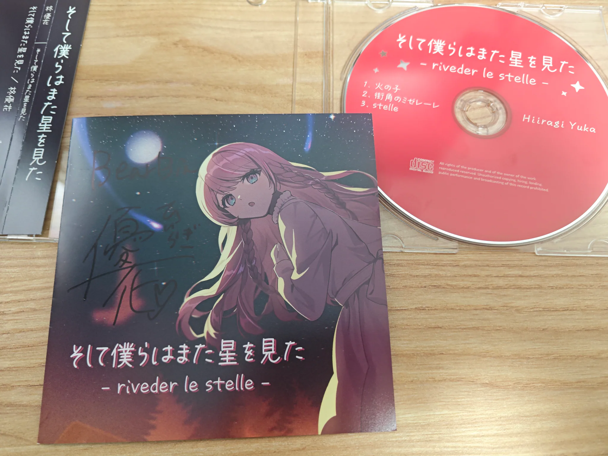
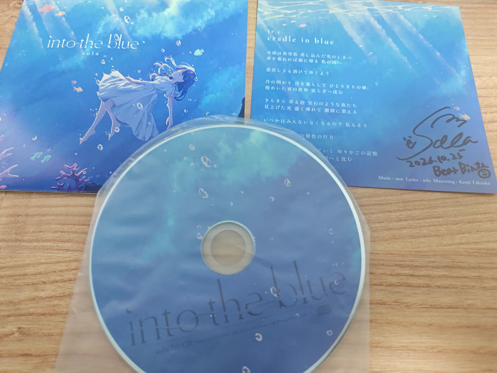
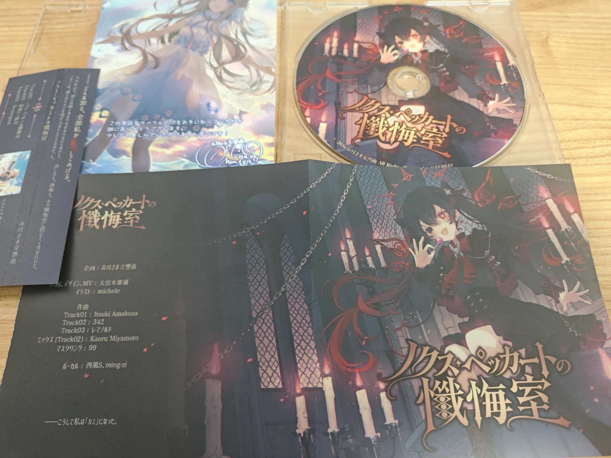
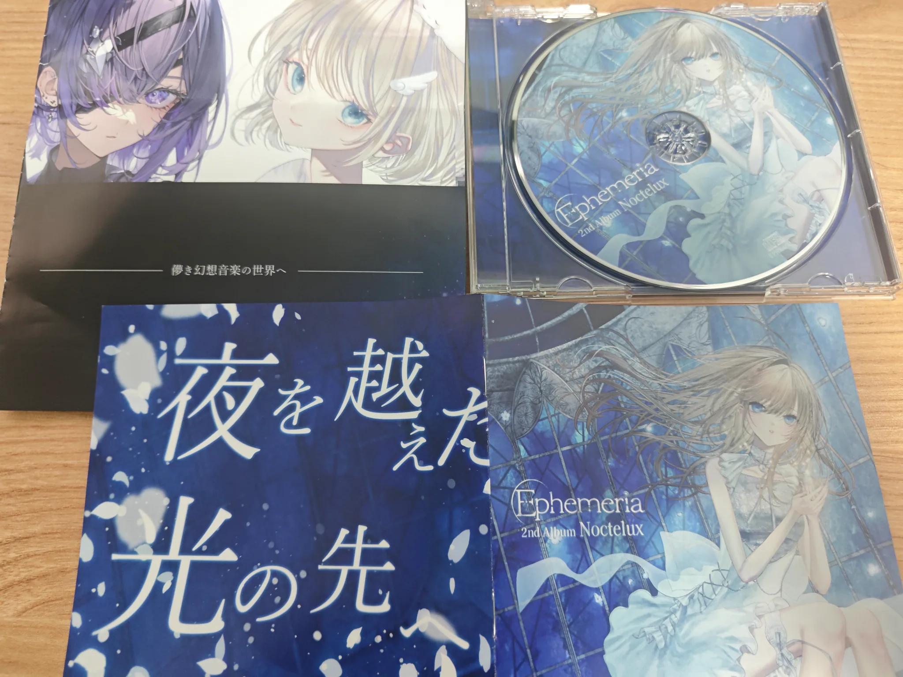
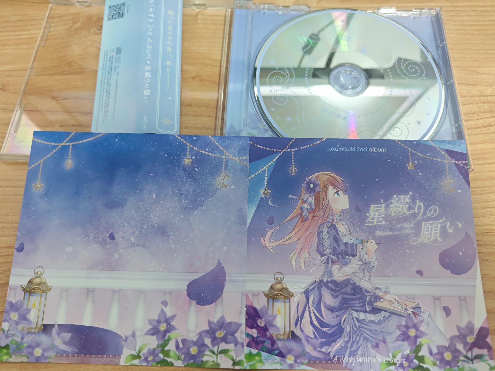
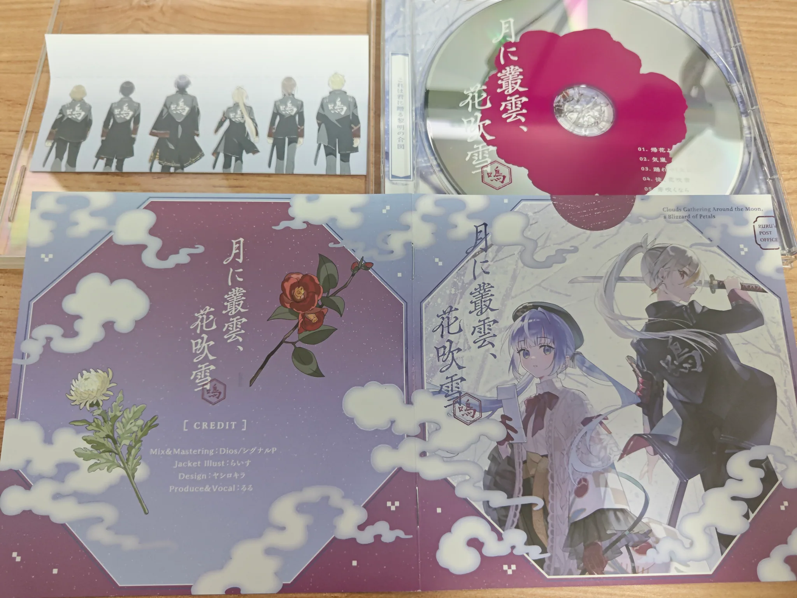

2026年秋[M3](https://mzh.moegirl.org.cn/Music_Media-Mix_Market) 于10月25日在东京流通中心举办。本次我也是买了点专辑，就写篇博客记录一下感想。

这次一共是买了10张新专辑，4张场贩、6张通贩，跟春M3差不多。大多数专辑来自之前不感兴趣的社团，属于是相当惊喜的一次。

## 开箱视频

:::bilibili BV13ayxzpE4B

## 场贩

跑场贩基本就是为了场贩限定或者签名去的。找代购跑了4张场贩专辑，都是签名专。

### 西坂恭平

- [试听(YouTube)](https://www.youtube.com/watch?v=Ln31wcvnWLA) | [试听(bilibili)](https://www.bilibili.com/video/BV173p46cErY)

西坂恭平的冷饭专，基本上就是他过去给各个 Galgame 提供的曲子。最出名的两首是来自《[若能与你再次相见](https://mzh.moegirl.org.cn/若能与你再次相见)》的《Re:Call》，和来自《[生命的备件](https://mzh.moegirl.org.cn/生命的备件)》的《Liblume》，相信听过的人不少。

这次专辑12首冷饭，其中6首重制。专辑第13首则是新曲。这次有幸拿到了西坂恭平的签名，相当难得，这位对M3来说可是稀客啊。展会结束后看他推上一直没有发通贩，估计真是场贩限定了，万分庆幸搞了场贩。

### 柊优花

- [试听(X)](https://x.com/hiiragi_yuka530/status/2110676795771232733) | [试听(bilibili)](https://www.bilibili.com/video/BV1kFJb6eE7s)

对于不熟悉同人音乐的人来说，优花可能作为《[魔裁](https://mzh.moegirl.org.cn/魔法少女的魔女审判)》中橘雪莉的配音演员更为熟悉。

这次也是跟春M3一样买了一张签名专。想起春M3的时候优花把名签到了壳子上；然后这次又深色底黑字，不太好辨认，代购发照片的时候我也是认了半天才确定这是我的签名专😂。

优花以往的风格可能相对更萌一点，属于我比较不感兴趣的类型。今年这两张都属于有史诗感的，总体旋律相当优美，相当戳我，所以也是毫不犹豫购入。

### sola

- [特设网站](https://sola7th-blue.pages.dev/) | [试听(YouTube)](https://www.youtube.com/watch?v=WZPbOSwnaEI) | [试听(bilibili)](https://www.bilibili.com/video/BV1mmJt6kEUA)

这次 sola 的新专相当惊艳啊，两首歌都很好听。第一首钢琴主奏，曲调柔和，跟 sola 的歌声配合得天衣无缝。第二首更是无敌，mawari 写的歌实在是太棒了，展会之前我就可以对着试听反复听好多好多遍。

包装这块比较简单，纸盒子、一张歌词。名字是签在歌词上，非常可爱的签名设计。

### Isle & Notes (Fty × mawari)

- [特设网站](https://isln-1002.pages.dev/) | [试听(YouTube)](https://www.youtube.com/watch?v=eWzPQVBPQ9w) | [试听(bilibili)](https://www.bilibili.com/video/BV1qPp36UEcB)

Fty + mawari + 水月茉莉，三人份的签名啊我去，爽死我了。

Isle & Notes 的专辑还是一如既往的夯，我愿称之为最佳女人唱歌社团，连着几张专辑的歌都能长期待在我歌单里。就喜欢这种作曲家组的社团，每次都能写出我很喜欢的曲子。

这次和首专一样属于 mini 专辑，共6首歌。每首都很好听！尤其最后一首，前面77s的伴奏是钢琴主奏，实在是太好听了！有三首双人合唱，都超级棒，我对于这种合唱基本上没有抵抗力。

这次还附带一张明信片，好看。

## 通贩

### Eresia Lily (mopi × マドロミ)

- [特设网站](https://reminiscia.pages.dev/) | [试听(YouTube)](https://www.youtube.com/watch?v=HMc77QfqtKU) | [试听(bilibili)](https://www.bilibili.com/video/BV1PbJi6ZECo)

mopi 和マドロミ合作的新社团首张专辑。阵容十分强大，るる、つぐ等都是我很喜欢的歌手。

mopi 的曲子风格相当独特，让我形容的话就是诡异+优美，つぐ在春M3的专辑tr4就是 mopi 作曲，也是这样的风格，听起来有点上头。

### solfa

玩旮旯给木的应该比较熟，好多游戏都是他们供的曲，歌手阵容也都是 Galgame 常客。Ceui 是我最喜欢的歌手之一，好喜欢她的嗓音。

solfa 这次是出了两张专辑，我就买了其中一张歌手阵容更喜欢的。一张3000日元还有点小贵。

### お月さま交響曲

- [特设网站](https://nox-peccato.pages.dev/) | [试听(YouTube)](https://www.youtube.com/watch?v=umho2YSDlEE)

お月さま交響曲的歌我之前都不怎么感兴趣，但这次的tr3是真的好听。

我想说的就是您B站号已经一年多没动了，什么时候动一下啊。

### Ephemeria (NiLBana × 雨澄爱)

- [试听(YouTube)](https://www.youtube.com/watch?v=E1w-BVLpzd8) | [试听(bilibili)](https://www.bilibili.com/video/BV1qHHL6fEL4)

NiLBana 跟雨澄爱合作社团的第二张专辑，总体上风格和春M3的首专差不多，封面画师也都是同一个人。~~但是这封面胳膊是不是有点太细了~~

NiLBana 写的歌真是不错，总体节奏非常的舒适。

这次试听的时候感觉雨澄爱唱出了两种声线，不知道是不是时间上有跨度。

如果关注 Galgame 的可能知道一部作品《[流星 -a Wish Star-](https://mzh.moegirl.org.cn/流星_-a_Wish_Star-)》，OP就是他们两个的组合。

### おくみずき

- [特设网站](https://wish-written-in-stars.pages.dev/) | [试听(YouTube)](https://www.youtube.com/watch?v=LNSRXBd6HFY) | [试听(bilibili)](https://www.bilibili.com/video/BV1LFpE6vEPX)

这次这张真的好好听，试听的时候就好几首中意的，全曲听起来也是没令我失望。

第3首《消えない夢》听起来略有些《灰色的果实》《灰色的乐园》动画OP的感觉，不知道是不是错觉。

第5首《花便りの向こうへ》属于是我心目中本专最佳，おくみずき跟咲良ゆの合唱的，就喜欢这种。顺带一提ゆの这次的专辑没什么感觉，反而这张颇有感觉。~~你听的ゆの何必是ゆの自己的专辑~~

### るる

- [特设网站](https://ruru0005.pages.dev/) | [试听(YouTube)](https://www.youtube.com/watch?v=pGdV9ArbXXQ) | [试听(bilibili)](https://www.bilibili.com/video/BV1Rcp86YEWU)

说到るる这次的新专，就必须得提一下这tr1前面9秒的小提琴独奏，这直接把琴拉到脑子里[^1]的感觉太™带劲了，M3之前我就是对着试听反复循环前面这几秒，越听越带劲。不愧是 Fty，るる之前的怪盗专第一首《余白の庭》也是这样，那小提琴越听越爽。

第四首《徒、花吹雪》也很好听，非常喜欢这种柔和抒情的曲子。

## 杂项

这次秋M3开始前看到群友说 YMP 的推特动了，快的话明年春M3回归、慢的话就秋[^2]，~~死了的心又悬起来了~~。这下让我秋M3还没开始就在期待下个春M3了，好急好急好急好急好急。

此外，没记错的话春M3还是 Netlify 为主的，这次特设网站都搭在 Cloudflare Pages 上面，不知道是不是 Netlify 的免费策略变了。

[^1]: 群友的形容
[^2]: [1番順調で早ければ4月のM3、少し余裕を持ってだと来年10月目指してみようかな](https://x.com/pagumin/status/2107352538643071275)
